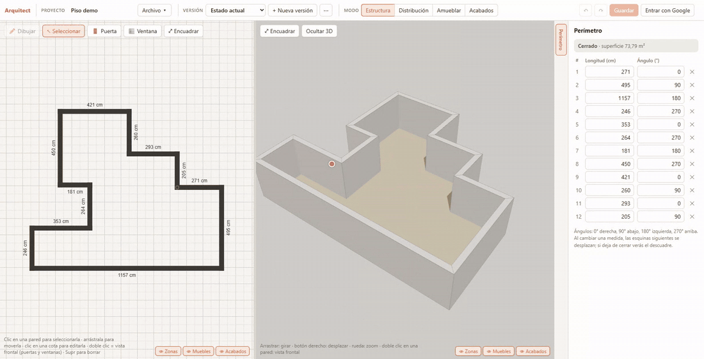
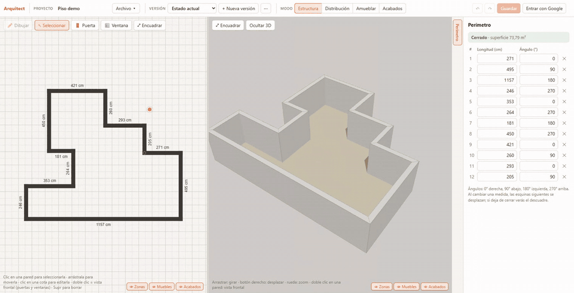
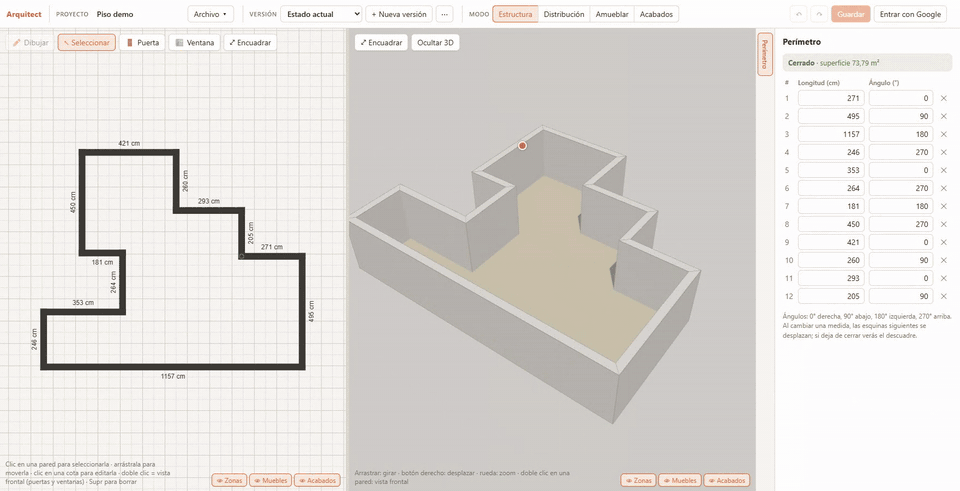

# arquitect-app

[](https://github.com/manuelcarro97/arquitect-app/actions/workflows/ci.yml)

Editor de planos de viviendas en el navegador: dibujas el perímetro de un piso en 2D, distribuyes el interior, lo amueblas, eliges acabados y lo ves en 3D al mismo tiempo. La interfaz está en español y las medidas son en centímetros.



**Demo:** https://reformas-app-5f07c.web.app

## Funcionalidades

El editor tiene cuatro modos (barra superior):

- **Estructura**: perímetro exterior dibujado como pasos de longitud y ángulo (con ajuste de ángulo configurable y longitud tecleable). Tabla de tramos para editar la longitud y el ángulo de cada pared. Distribución y amueblado quedan bloqueados hasta cerrar el perímetro.
- **Distribución**: tabiques interiores y zonas (estancias con nombre, color y superficie en m²). Puertas y ventanas sobre cualquier pared, con detalle (ancho, alto, alféizar, bisagra, hacia dónde abre) y una vista de alzado de la pared.
- **Amueblar**: catálogo por categorías (salón, comedor, dormitorio, cocina, baño, otros) con piezas en caja y 83 modelos 3D; medidas y giro editables.
- **Acabados**: pintura, revestimientos y suelos por cara de pared, por zona o general.

Mover paredes actualiza las medidas y la vista 3D al momento:



Puertas y ventanas se colocan sobre la pared y se deslizan a lo largo de ella:


Los tabiques dividen el piso y las zonas marcan habitaciones con nombre, color y superficie:



Además:

- Vista 3D en tiempo real (sombras, texturas generadas por código para los materiales, vista frontal de una pared con doble clic).
- Deshacer y rehacer (Ctrl+Z, Ctrl+Y), selección y borrado con Supr.
- **Versiones** de un mismo proyecto (por ejemplo "Estado actual" y "2 baños"): se puede crear una vacía, solo con el perímetro o duplicando la actual.
- Diseño para móvil en vertical (vistas 2D y 3D apiladas, panel inferior y botones táctiles) y gestos táctiles.
- Autoguardado local en el navegador, copia de seguridad en fichero (`.reforma.json`) y guardado en la nube con Google.
- Importación de carpetas de proyecto de versiones antiguas de la app (solo navegadores que abren carpetas, como Chrome o Edge en ordenador).

## Stack

React 19, TypeScript, Vite, Zustand + zundo, Zod, Konva (react-konva), Three.js (React Three Fiber + drei), Firebase (Auth con Google y Firestore, hosting en Firebase Hosting), Vitest, ESLint.

## Arquitectura

```
src/
├─ domain/        Reglas del plano, sin React ni navegador: geometría, perímetro,
│                 tabiques, aperturas, zonas, mobiliario, acabados y versiones
├─ store/         Estado de la app (Zustand): proyecto, selección, modo, deshacer/rehacer
├─ persistence/   Formatos de fichero, validación al leer, autoguardado y copias de seguridad
├─ cloud/         Firebase: login, conversión proyecto <-> documentos de Firestore, CRUD en la nube
└─ ui/
   ├─ editor2d/   Plano 2D con Konva, un controlador por modo, ajuste (snap) y gestos táctiles
   ├─ viewer3d/   Escena 3D: paredes con huecos, suelos por zona, mobiliario, aperturas
   └─ ...         Barra superior, paneles de cada modo, catálogo de muebles y materiales
```

El dominio no importa nada de la UI. La UI y el store lo usan; el 3D y el 2D leen el mismo proyecto, así que no hay dos fuentes de verdad.

## Decisiones técnicas

- **Dominio puro con `Result`.** Las operaciones del dominio (`appendSegment`, `addOpening`, etc.) son funciones que reciben un `Floor` y devuelven un `Result` con el nuevo suelo o un código de error (`PERIMETER_NOT_CLOSED`, `OPENING_OVERLAP`...), en vez de lanzar excepciones. El store solo aplica la operación y registra el error si la rechaza. Las reglas se prueban sin montar ninguna interfaz.
- **Zustand + zundo para deshacer.** El proyecto es un objeto inmutable; zundo guarda solo `project` (`partialize`), compara por referencia y conserva hasta 200 pasos.
- **Zod al leer datos externos.** Todo lo que viene de fuera (autoguardado, copia de seguridad, nube) se valida con Zod en `persistence/floorFormat.ts` y lleva un `formatVersion`, de modo que los ficheros antiguos se pueden actualizar al leerlos.
- **Perímetro como pasos "tortuga".** Cada pared guarda longitud y ángulo respecto a la anterior, no coordenadas; así se edita con números y el cierre del perímetro se puede comprobar (`closureGap`).
- **Konva para 2D y Three.js para 3D.** El plano usa canvas 2D con Konva; la vista 3D se carga en un chunk aparte (`lazy`) para que el editor aparezca primero.
- **Firestore: un documento por versión.** Un proyecto se guarda como un índice más un documento por versión (`users/{uid}/projects/{id}/versions/{id}`); cada documento queda lejos del límite de 1 MB y un guardado solo reescribe las versiones que cambiaron.
- **Aviso de conflicto al guardar.** El navegador recuerda la última fecha de modificación en la nube que conoce de cada proyecto; si la copia de la nube es más nueva, pregunta antes de sobrescribir.
- **Reglas de Firestore por propietario.** `firestore.rules` solo permite leer y escribir en `users/{uid}` al propio usuario, con email verificado y presente en la lista de cuentas autorizadas.
- **La configuración web de Firebase está en el código.** Son valores públicos que solo identifican el proyecto; lo que protege los datos son las reglas.

## Ejecutar

Requiere Node.js (probado con la versión 22).

```bash
npm install
npm run dev        # servidor de desarrollo
```

Otros scripts:

```bash
npm test           # tests (Vitest)
npm run typecheck  # TypeScript
npm run lint       # ESLint
npm run build      # typecheck + build de producción
```

La integración continua (GitHub Actions) ejecuta `typecheck`, `lint`, `test` y `build` en cada push y pull request a `main`.

Los tests cubren el dominio (geometría, perímetro, aperturas, tabiques, zonas, mobiliario, acabados), la lectura/escritura de formatos, el autoguardado, la conversión a documentos de Firestore y parte de la geometría 3D de las paredes. No hay tests de interfaz ni del flujo con Firebase.

## Limitaciones conocidas

- **Guardar en la nube está restringido a cuentas autorizadas.** Las reglas de Firestore solo dejan escribir a las cuentas de Google incluidas en el documento `config/allowedOwners` (campo `emails`). Cualquier otra cuenta recibe "Tu cuenta no tiene permiso para guardar en la nube".
- **Sin iniciar sesión la app funciona, pero sin guardar en la nube.** Puedes editar todo; pulsar Guardar avisa de que hay que entrar con Google. Lo único que se conserva es el autoguardado local del navegador (`localStorage`) y la copia de seguridad en fichero.
- Si ejecutas tu propio proyecto de Firebase tendrás que sustituir la configuración de `src/cloud/firebase.ts`, crear el documento `config/allowedOwners` y desplegar las reglas.
- El bundle es grande (el chunk de 3D pesa más de 1 MB sin comprimir).
- Los tramos curvos están reservados en el modelo de datos (`arc`) pero no implementados.

## Licencia y créditos

Código bajo licencia [MIT](LICENSE).

Los modelos 3D de `public/models/kenney` son el *Furniture Kit* de [Kenney](https://www.kenney.nl), publicados bajo CC0 (ver `public/models/kenney/License.txt`).
